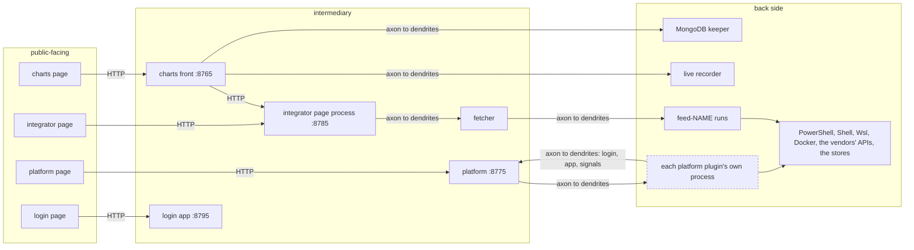
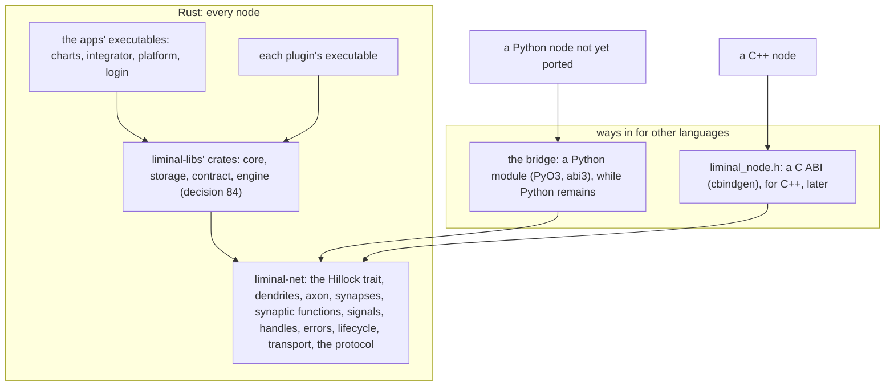
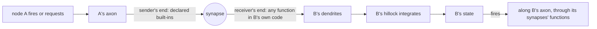
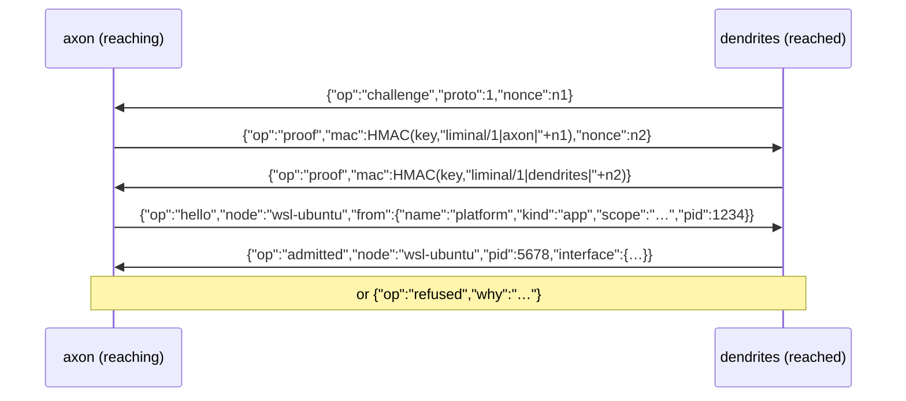
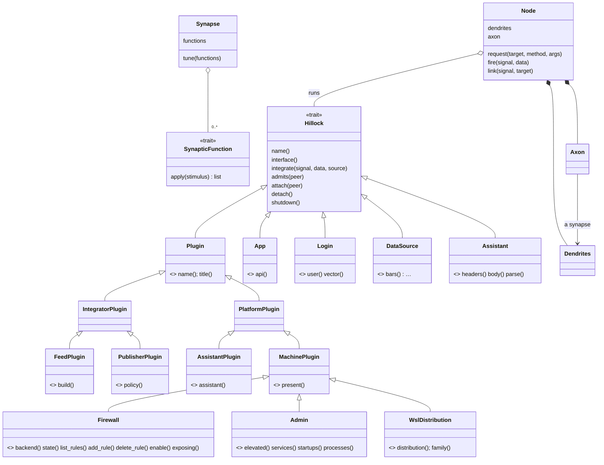

# Liminal as a network of nodes, in Rust: the design

Status: **draft for review**. It was first written on 2026-11-09 for Python on a Rust core, then revised the same day
for a full rewrite in Rust. Its home is liminal-net (decision 80); liminal-libs keeps a pointer.
- Built: liminal-net 0.1, the network in Rust (§3.4), with its tests and the test vectors of §5.7; and 0.2, the
  Python bridge (§4.9).
- Decided and not built yet: a node's queue and its own thread (§4.11), in-process delivery (decision 42), and the
  macro that writes an interface from its trait (decision 38). They come with liminal-net 0.3.
- Decided: 1–15, 17–22, 25, 27, 28, 35–40, 42–56, 58, 60, 62–64, 67, 70–74, 77–84, 86–109 and 111–133.
- The research behind the platform slice's decisions found that several sections below describe a lifecycle and
  interfaces the platform does not have today. The decision log (§10) is current; the sections are corrected to
  it as the walk goes, and where the two disagree the log holds.
- Retired by the rewrite: the rows marked so.
- Every other decision in the log (§10) stays open until the user decides it, and the code follows only decided
  items.

## 1. What the user asked for

In the user's words, 2026-11-09:

- "the idea is to make sure all modular code uses abstract base classes as interfaces and Inter Process
  Communication to interact between code objects"
- "ALL ABSTRACT BASE CLASSES PROVIDE ALL INTER-PROCESS COMMUNICATION METHODS, AS WELL, AN 'AXON' from which to
  receive requests, ABC form the foundation for internetworking between code objects and API's" — "*not all"
- "basically all code objects, including parts of plugins become internetworked stateful code objects that interact
  in real time"
- "the hillock will be the ABC that interlinks with other nodes, the axon it's input interface will accept
  connections for input, and dendrites, will extend to other nodes and request access to their axons". In the
  decision walk the user then chose biology's direction (decision 4): a node's dendrites take its input, and its
  axon is its output.
- "also, the nodes are structured much like neural networks"
- "the public facing nodes which interact with the user manage input and display, where as the intermediary nodes
  handle logic, and the back side manages OS/API/low level interactions". On how a node knows its side: "for this
  one, the nodes have to find a way to self organize" (decision 5).
- "we are using the existing libraries as the desired output and input and code organization", "the existing UI"
- "it has to look and behave very much the same way, but requires a very much different kind of paradigm in terms
  of coding, it will also require the ability to be interlinked against different compilers' code and libs" — "like
  i will have rust and maybe c++"
- "this is going to be a very extensive rewrite and conceptual design"; "we will have to walk through a lot of the
  decisions you make in order to make sure nothing is skipped over"
- "at each synapse, callbacks or variable functions can be used to filter stimulus our input in order to logically
  order output correctly"
- "can we do this in rust, the base networking, and run python abstractions on top ?"
- "is there a way to have python functions embedded in these nodes" ("pay in mind, they are rust based"), "is there
  a way to use the same types of datatypes/constructs that python uses, in rust ?", and then: "then. lets do a full
  rewrite in rust. All liminal-net stuff will be done in a few days"
- During the platform slice's walk, the same day: "nodes are meant to wrap stateful objects, when an object
  receives many updates (inputs) or needs to output frequently, to the point where the program/process is not able
  to give enough real processing priority to processing the queue of a node, then the node needs to take a thread
  with in the context of the process, and run autonomously." (§4.11)

Their answers on the rewrite's scope:

| question | answer |
|---|---|
| Python where Rust lacks a library (only `exchange_calendars`) | Rust everywhere: the calendars are ported too, and no Python remains at the end |
| How the rewrite replaces the Python that runs today | Node by node: Rust and Python nodes speak one protocol, each piece is swapped once its Rust version gives the same outputs, and the apps keep running throughout |
| Where the Rust lives | The same repositories: each gets its crate, and its Python leaves as its pieces are replaced |
| The first slice after liminal-net | The platform and its plugins |

The requirements drawn from them:

| | requirement |
|---|---|
| R1 | It looks and behaves the same. Every route and its answer, every command and its output, every file and database, and the UI's HTML, JS and CSS stay as they are (§8). |
| R2 | The organization stays: the same repositories, and each crate's modules keep today's names (`machines/wsl.py` becomes `machines/wsl.rs`). The paradigm is new: nodes that interact only by requests and signals, through their dendrites and axons. |
| R3 | Nothing on the wire or in an interface belongs to one language. Rust is the implementation. C++ can join through a C ABI, and Python through the bridge while it remains. |
| R4 | The network is structured like a neural network, on three sides, which the nodes organize themselves. |
| R5 | Nodes are stateful and real time. Nothing runs unless used (the user's rule of 2026-11-01), and data is secured before a process ends. |
| R6 | Every decision is walked through with the user; nothing is skipped over. |
| R7 | At each synapse, callbacks or variable functions filter the stimulus, so that output comes out in the right logical order. |
| R8 | Rust everywhere. Python appears only in nodes not yet replaced, through liminal-net's bridge. One exception, the user's choice of 2026-11-09 (decision 122): Cursor and Copilot stay Python for good, so the bridge stays for them. |
| R9 | A node wraps a stateful object and has a queue of its own. A node whose queue its process cannot serve fast enough takes a thread of its own within that process, and runs autonomously (§4.11). |

## 2. The terms

The direction is biology's (decision 4): a node's **dendrites** take its input, and its **axon** carries its output
to other nodes' dendrites.

| term | meaning |
|---|---|
| **node** | A stateful code object of the network: a plugin, a part of a plugin, an app, a login, a source, an assistant, a service. It has a name among the nodes, and its state lives as long as its process. |
| **Hillock** | The trait every node realizes (`liminal_net::Hillock`). It interlinks the node with others: it integrates what reaches the node's dendrites into the node's state, and fires the node's signals along its axon. |
| **dendrites** | A node's input. They accept synapses from other nodes' axons, admit or refuse them, run each synapse's functions, and take in the requests and signals that arrive. |
| **axon** | A node's output. It reaches other nodes' dendrites and requests access. It carries the node's requests out and their answers back, and fires the node's signals to the nodes linked for them. Through it, a node holds another as that node's own trait, through a client generated from the trait. |
| **synapse** | Where one node's axon meets another node's dendrites: a single connection. Answers travel back across it, as retrograde signals do in biology. (The word is this design's: decision 2.) |
| **stimulus** | Whatever crosses a synapse towards the dendrites: a request or a signal. |
| **synaptic function** | A callback or variable function at a synapse, applied in order to each stimulus crossing it, before the receiving node takes it in. It filters, reshapes, orders, holds back or combines, so that the output comes out in the right logical order (R7). "Variable": it can be replaced while the link is live (§4.8). |
| **request** | A call of one of a node's interface methods. It goes along the caller's axon into the node's dendrites, and is answered back across the same synapse. |
| **signal** | Something a node fires: a status changed, a line printed, a sample taken. It travels along the axon to the dendrites of the nodes linked for it, and their hillocks integrate it. It is never answered. |
| **message** | Data that travels between nodes (a status, a rule, an argument, a report), carried by value. A message is not a node: this is the user's "not all" (decision 3). |
| **side** | Where a node stands: public-facing (the user's input and the display), intermediary (logic) or back side (the OS, the APIs, low-level work). Nodes find their side themselves (decisions 5 and 67). |
| **interface** | What a node offers: its methods, with their arguments' and answers' types, and its signals. Its dendrites serve nothing else. It is described language-neutrally, generated from its Rust trait (§6). |
| **handle** | How a node or a callable is passed in a message: an id the receiver uses to reach it, released explicitly. |
| **scope** | What names a set of nodes' addresses: the reaching app's state (its database, or its folder), through host.py's digest (decisions 14 and 82). Two scopes never share a process. |
| **bridge** | liminal-net's Python module (decision 62): how a Python object takes part as a node while the Python is replaced, piece by piece. |
| **queue** | A node's own line of what waits for it: the signals that arrived for its state, taken in order, one at a time, and the signals it fires. Requests run beside it (decisions 48 and 95). |
| **autonomous** | A node that has taken a thread of its own within its process, because its queue was not served fast enough or because it declared so. It keeps the thread until it ends (§4.11). |

## 3. How the network works

### 3.1 Like a neural network

- **Links are directed**: an axon reaches a node's dendrites. Two nodes that both start conversations hold a synapse
  each way. The platform's axon reaches a plugin, and the plugin's axon reaches the platform for its login and to
  fire its signals.
- **Requests** go along an axon into a node's dendrites, and are answered back across the same synapse.
- **Signals propagate forward, like activations.** A node fires, and its signal travels along its axon to the
  dendrites of every node linked for it. Each receiving hillock integrates it into its node's state, and may fire in
  turn.
- **Synaptic functions on every link** (R7). Each stimulus crossing a synapse passes the link's functions in order
  before the receiving node takes it in (§4.8). Per link, they filter, reshape and order. Per node, the hillock
  integrates what all its links deliver.
- **Integration at the hillock**, as in a neuron:
  - a burst of the same state signal becomes one, the latest, at most once per interval (decision 20);
  - nothing fires when nothing changed;
  - stream signals (lines, rows, ticks) are delivered every one, in order (decision 43).
- **Three sides.** The user's input enters at the front. Requests travel through the logic to the back side. What
  happens at the back side fires forward through the logic, integrated at each hillock, to the display. Any node may
  still link to any other.
- **The sides organize themselves** (decisions 5 and 67). A node declares no side. The network works it out from
  the node's links and from what the node touches:
  - a node the pages reach is public-facing;
  - a node that reaches the OS, outside hosts or the stores is the back side;
  - the rest is intermediary.

  The network recomputes this as links change, and Connections shows it.

### 3.2 The three sides, with Liminal's nodes

These are the existing classes, in their existing modules. In Rust they keep the same names (R2).

| side | manages | nodes |
|---|---|---|
| public-facing | the user's input and the display | each app's page in the browser, and the HTTP side of its dendrites: the charts front (`liminal_charts.gui.front`) and chart server (`gui.server.ChartApp`), the integrator's page process (`liminal_integrator.service`), the platform (`liminal_platform.app.PlatformApp` routes), the login (`liminal_login.app.LoginApp` routes). The views: the charts' Stock, Analysis, Trading, Watchlist, Preferences; the integrator's Exchanges, Markets, News, Federal, Datasets, Live, Fetcher, Plugins, Resources, Databases; the platform's This machine, each plugin's page (its tables, forms and terminal as the platform draws them), and Connections. The trays |
| intermediary | logic | the apps' logic: `ChartsApp`, `IntegratorApp` and the `Fetcher` with its assessment and standing pass, the `Service`, `PlatformApp`'s nexus (validity, enabling, attaching), `LoginApp`'s users and vault. The library's logic: `collector.Collector`, `coverage.Planner`, `sourcing.Scheme`/`Scans`, `audit.Auditor`, `initializer.Initializer`, `derive.Builder`, `baddata.Scanner`, `runner.Runner`, `publications.Reader`, `killswitch.KillSwitch`. Each plugin's own logic: a feed's plans and declarations, a publisher's feeds and policy, an assistant's plans and models, a machine plugin's hooks (a WSL plugin's installs and steps, a firewall's groups and risk checks, hw-stats' figures, Namecheap's zones). The login's realizations: `EnvironmentLogin`, `LoginClient`, `RecordingLogin` |
| back side | the OS, the APIs, low-level work | the drivers: `machines.windows.PowerShell`, `machines.linux.Shell`, `machines.wsl.Wsl`, `docker.Docker`, `machines.terminal.Terminal`'s PTY, `capture`, `netpath`, `dns`, `ports`. The vendor clients: each feed's `DataSource`, `sources.http.HttpClient`, `assistants.AssistantClient`, Namecheap's API client, the publishers' reads, `wsclient` and `sources.stream`'s live feeds. The stores: `storage.Store` on SQLite, `stores` on DuckDB, `mongo`'s keeper. The machine ledgers (`ratelimit.MachineLedger`). The network's own pipes |

A plugin's parts sit on all three sides. The WSL plugin's tables and terminal are on the front, its installs and
steps in the middle, and `Wsl`, `Shell` and `wsl.exe` at the back. So the parts of plugins become nodes on their own
sides (decision 7).

### 3.3 The processes



Dashed: new. Today the platform's plugins run inside the platform's own process, and host.py's pipes carry pickled
dicts. In the target every process is a Rust executable. Until its piece is ported, it is the Python one, on the
bridge.

### 3.4 The code's layers: Rust everywhere (R8)



**One implementation of the network.**
- Rust nodes link liminal-net directly.
- Python nodes, while they remain, go through the bridge; C++ goes through the C ABI.
- No language reimplements the protocol. The exception would be decision 62 choosing a pure-Python speaker for the
  bridge period, and that would be checked against the same test vectors (§5.7).

**What liminal-net holds** (0.1, built):

| module | what it does |
|---|---|
| `frame` | the frames of §5.2 |
| `handshake` | the challenge and proofs of §5.3 (the `hmac` and `sha2` crates) |
| `key` | host.py's own key file, made once with create-new |
| `address` | host.py's digest under the `liminal-net-` prefix (the `sha1` crate) |
| `transport` | named pipes on Windows (one node per name, an access list for this user only), Unix sockets elsewhere, through tokio |
| `message` | the ops of §5.4, peers, targets, typed records (`serde_json` with its keys kept in order) |
| `hillock` | the `Hillock` trait: a node's own code |
| `node` | the node runtime: serving, the lifecycle, firing along the axon, the links' functions, the latest of each signal |
| `dendrites` | one task per synapse: the admission, requests run concurrently on worker threads, signals in order |
| `axon` | reaching nodes, a resident node's windowless start (host.py's flags 0x08000208), waiting for one securing its data |
| `synapse` | a synapse from the axon's end (`Remote`): requests matched by id, links, the quiet end |
| `functions` | the eight built-in synaptic functions, and any closure at the receiver's end |
| `handles` | what a node lends, and the handles it holds |
| `errors` | `$error` records and the network's own errors |
| `lifecycle` | the times: the start wait, the grace, the hello wait, the quiet time, coalescing |
| `idl` | the interface descriptions. In 0.1 a node builds its own with a builder; the derive that writes it from a trait comes with the first traits, in the platform slice |

A node's name and kind are its configuration (`NodeConfig`), not its trait's, so the same code can run as several
nodes. Its code is plain functions on worker threads (decision 60). It reaches other nodes with the blocking forms
(`reach_blocking`, `request_blocking`), and fires from any thread.

**What each repository's crate holds:**
- liminal-libs: the traits that are today's ABCs (§9's table), the records as structs, and the shared parts;
- each app: its executable, whose HTTP side serves today's pages and routes;
- each plugin: its node executable.

**What it takes:**
- The Rust toolchain: installed (decision 63).
- The crates from crates.io, asked once by list before the first build (decision 79): approved on 2026-11-09 and
  fetched (tokio, serde, serde_json, indexmap, hmac, sha2, sha1, getrandom, thiserror, windows-sys, and what they
  pull in).
- The bridge: maturin from PyPI, asked before its build (decision 62): approved and installed in `app\.venv` on
  2026-11-09 (maturin 1.16.0, PyO3 0.30.1).
- liminal-net's repository: local, at `source\liminal\net`. It goes to GitHub only on the user's yes
  (decision 58).

## 4. The rules

### 4.1 What crosses, and how

| what | how |
|---|---|
| messages: maps, lists, text, numbers, booleans, null | by value, with the wire types of §5.5 |
| typed records: the library's records (`Rule`, `Startup`, `docker.Instance`, `Report`, `Scanned`, `Argument` and its kinds ...) | by value, as `{"$type": "<name>", ...fields}`. Rust reads a struct (serde), and the bridge rebuilds the Python dataclass. |
| nodes, and callables (a `log`) | by handle: `{"$node": id, "traits": [...], "owner": {"node": ..., "scope": ...}}`. The receiver holds a client built from the node's interface description. A handle is answered at its owner's dendrites (decision 44), which the `owner` names, and released explicitly when done. A synapse closing releases all of the handles lent over it. No language's garbage collector is assumed. |
| errors | records: `{"$error": "<kind>", "message": "...", "accept": ..., "denied": ..., "status": ...}`. The kind is named as today's class (`CommandError`, `Refused`, `NotEntitled` ...), so every side agrees. Rust maps it to an error enum that keeps the kind, the words, `accept` and the status. The bridge rebuilds the Python class when it can import it, else a `RemoteError` that keeps the builtin base. The platform's 400/502 mapping and a form's second confirmation depend on that. |

### 4.2 Access

1. **Your key.** The synapse's handshake proves both ends hold the user's key, without sending it (§5.3). The key is
   host.py's own file: `LIMINAL_IPC_DIR`, else `~/.liminal/ipc`, then `key`. Only this user's processes connect.
2. **The node's `admits(peer)`.** The hello names who is reaching (its node name, its kind, its scope, its
   process), and the node's policy admits or refuses: who may connect, and how many. A plugin admits its app's
   namespace; an app admits its plugins. This is the attachment policy the user asked for on 2026-11-03 ("plugins
   can regulate which or how many integrators attach to them").
3. **The login's gating.** What a node may do for the signed-in user stays the `Login` trait's (`may`, the pairs),
   as on 2026-11-06: "the app plugins need to use the Abstract Base Class login as the only way to present an
   interface for IPC, between plugins and login and the app as far as AUTHORIZATION".

Reach: this machine only, a named pipe on Windows and a socket file on Linux, as host.py today. The transport is
pluggable, so reaching other machines would be its own decision later (decision 15).

### 4.3 Lifecycle

- **Nothing runs unless used.** A node's process starts at the first request an axon brings it. A disabled plugin
  never starts one. Neither does a node whose only use is its declarations or pure functions (§4.6).
- A synapse with no request and no link for LIMINAL_QUIET_SECONDS (120 s) closes.
- When a node's dendrites hold no synapse any more, the node is told. A resident node then:
  - waits a short grace (10 s, for a page reload);
  - lets a request in progress finish (a setup step);
  - runs `detach` and `shutdown`, securing its data;
  - and its process exits.

  The user, 2026-11-01: "the plugins should have some sort of resident IPC mechanism that tells them when the
  client process is no longer attached, and then presto, the plugin gracefully shuts down after all data is
  secured".
- A synapse that arrives while the node secures its data waits for that end, then starts the node again. It never
  starts a duplicate beside it (decision 83).
- A request still running when its caller is gone (a setup) finishes. Its lines are kept in the node's own log.
- host.py's values stay for its hosts until they move (§4.10): 60 s idle (LIMINAL_IDLE_SECONDS), a 30 s start wait,
  a 5 s client check and a 5 s hello wait. The network's own values are decision 13's.

### 4.4 Real time

| member | what it does |
|---|---|
| `fire(signal, data)` | sends a signal along the axon, to every node linked for it |
| `link(signal, target)` | asks a node to extend its axon to `target`'s dendrites for that signal |
| `unlink(signal, target)` | the reverse |
| `integrate(signal, data, source)` | what a signal arriving at the dendrites does to the node's state. The runtime keeps the latest of each source and signal (`Node::latest`). Passing a signal on is the node's own choice, with `fire` (decision 89). |

- A new link for a state signal gets the latest one at once (decision 90).
- A signal's `seq` counts what was sent along that one link, after the sender's functions, so the receiver's
  `in_order` never waits for a gap that a filter made (decision 91).

- There is no status watch (decision 22). A plugin's status is worked out when a route asks for it, by a request
  to the plugin where today's code calls `status()`. Nothing is kept of it, and with no page open the platform asks
  no plugin anything.
- The pages keep their own polling: the existing UI is the reference (decision 21). The page asks for everything
  at its load and after an action, and then polls only the plugin shown: every 1 s during a path check, every 2 s
  for one with charts, every 30 s for one with tables.

### 4.5 Placement

- Within one process, nodes call each other directly. The synapse delivers without encoding, and the semantics stay
  those of the wire, so messages are treated as immutable. A test mode encodes even in-process, to prove that the
  two behave alike (decision 42).
- Each plugin, with its parts, runs as a resident node in a process of its own: its executable (decision 77). Each
  app's nodes live in the app's process.
- In the platform slice no part is shared, as today (decision 11): each plugin's process holds its own drivers
  (`Wsl`, `Shell`, `PowerShell`, `Docker`) and runs its own reads. A shared part as a node of its own is asked
  again after the slice, with measurements.
- A plugin's process lives while the plugin is active (decision 113): from the platform's start to its end for
  each plugin that is switched on and valid, as today's attachment. A plugin that is switched off, or not for this
  machine (decision 111), never has one.

### 4.6 What stays plain functions, and why

"Where it is not a detriment to performance" (the user, on objects). These are ordinary Rust functions inside a
node, never called across the wire:
- **The hot loops and the table work** (Polars, decision 75): the collector's request loops (`sync_bars`, `_fill`,
  `sync_future` ...), the storage queries, derive's aggregation, the calendars' masks (`sessions`), freshness's
  rules, the bad-data rules.
- **Pure functions of declarations and settings**:
  - the delivery scheme, the planners per symbol;
  - an assistant's validity (`keys_set`, `served`, `free_note`, `plan_state`, `rate_window`);
  - a feed's `carries`, `markets`, `served`, `plan_resolutions`, `request_bars`, `report`.

  They run in the caller's process, from the declarations loaded there (§4.7). Answering them remotely would cost a
  round trip per symbol. It would also mean shipping the settings, every variable and other plugins' keys too, to
  each plugin.
- **A feed's DataSource inside its run** (the bars' hot path). The run already is its own resident process
  (`feed-NAME`).
- **Between apps, HTTP on 127.0.0.1 as today**: page to app, the charts front to the integrator, `LoginClient` to the
  login app. `LoginClient` already realizes the `Login` trait over HTTP: it is the HTTP side of the login's
  dendrites.

### 4.7 Declarations stay where the plugin is found

An app holds each plugin's manifest (decision 77). The manifest carries:
- its name, title, version, icon, steps, keys and options;
- its interface description (§6).

Everything a page shows of a plugin that is not behavior is answered from the manifest. So a disabled plugin's
whole page (its row, its Settings, Connections, the tray) is answered without starting its process.

Behavior is every method of the plugin's trait. It is requested from the plugin's process through a client
generated from the trait, so the caller never knows where the plugin runs. A plugin reaches its app and its login
through its own axon.

### 4.8 Synaptic functions

The user: "at each synapse, callbacks or variable functions can be used to filter stimulus our input in order to
logically order output correctly".



**What one function is.** It takes one stimulus and gives back none, one, or several. That covers every case:
- dropping one (none);
- passing it on, or reshaping it (one);
- splitting one, or releasing several held back (several).

A function may keep state (what it holds back, the last value it passed), so each function is a small object of its
own. It is not a node, since it has no dendrites of its own (decision 55).

**What the functions do.** Each row is a built-in function. Every language implements the same vocabulary, so it
works whatever the other side of the link is written in (decision 51):

| function | does | e.g. in Liminal |
|---|---|---|
| `only(where)` | passes a stimulus whose fields match (equal, in, less or more than, present) | only an `error` row of the traffic |
| `pick(fields)` / `rename(map)` | reshapes, keeping some fields or renaming them | a status cut to what the platform's list draws |
| `changed(fields)` | passes only when those fields differ from the last passed | a plugin's `status` only when `valid`, `state` or `summary` changed |
| `throttle(seconds)` | at most one per interval, the latest kept | hw-stats' samples at 2 s while the page shows them, 30 s otherwise |
| `debounce(seconds)` | one after a quiet interval, the latest | a burst of firewall rule changes taken as one |
| `in_order(by)` | restores order by a sequence or a time field, holding early ones back until the gap fills or a limit passes | a setup's lines in the order printed; a request's progress before its end |
| `gate(until)` | holds everything back until a condition is met, then releases it in order | a job's lines held until its `started` arrives |
| `batch(n, seconds)` | gathers up to n, or what came within the interval, into one | traffic rows to Connections every 250 ms |

On requests only two of them apply, so a node's interface stays its contract (decision 53):
- ordering: `in_order`, or one at a time per key, so a `stop` never overtakes its `start`;
- refusal: `only`, as an access policy beside `admits`.

The arguments are never reshaped.

**Where they run** (decision 50):
- **At the receiver's end**, in the receiver's own code: any function. In Rust that is a closure; while Python
  remains, a Python callable through the bridge. This is the default.
- **At the sender's end**, so an unwanted signal is never sent at all: only the built-ins, declared as data in the
  `link` (§5.4).
- A callback of a third node (a handle) is possible, but it costs a round trip per stimulus. It is never used on a
  hot link.

**Variable** (decision 52):
- A live link's functions can be replaced (`tune`, §5.4). This is like a synapse's strength changing: the next
  stimulus already meets the new functions.
- The node that made the link may do it, or the receiving node.
- The change is noted in Connections, in its existing text (the link's hover, the Latest table): no new control.

**Ordering, overall** (decision 54):
- Per synapse, stream signals arrive in the order fired. Each carries a sequence number per source and signal, and
  `in_order` restores the order when concurrency mixes them.
- State signals: the latest wins.
- Across synapses there is no global order, unless a function orders by a field both sides share (a time, a job's
  id). That is how the logical order the user asked for is made explicit, link by link.

### 4.9 Python on the network, while it remains: the bridge (0.2, built)

The bridge is `liminal-net-py` (decision 62): liminal-net built as a Python module, `liminal_net`, with PyO3, one abi3
wheel for Python 3.12 and up. There is still one implementation of the network.

- **A Python object is a node's code.**
  - Its methods answer the interface's methods, as `method(*args, **kwargs)`. Or one `request(peer, method, args,
    kwargs)` answers them all.
  - It may also have `integrate(peer, signal, data)`, `admits(peer)` (`None` admits, text refuses with those words),
    `attach(peer)`, `detach(peer)` and `shutdown()`.
  - Its interface description is given beside it, as §6 writes it. Today's `Plugin.interface()` keeps its own shape
    and meaning.
- **Where Python runs.** The node's code runs on liminal-net's worker threads, never on its async ones. It holds the
  interpreter's lock only for each call (decision 61). Every call from Python into the network lets go of the lock
  while it waits, so Python and Rust never wait on each other's locks.
- **The receiver's own functions** may be Python callables, given the stimulus as a dict. They give back `None`
  (dropped), a dict (passed, perhaps reshaped) or a list of them. A built-in synaptic function runs in Rust, so a
  stimulus it drops never wakes Python.
- **Errors.** A Python exception crosses as a record: its class's name is the kind, `str()` the words, and
  `accept`, `denied` and `status` are taken from it. It comes back as `liminal_net.RemoteError` with those attributes.
  The network's own failures are `liminal_net.NetworkError`, a `ConnectionError`.
- **Values** cross as §5.5's types: a tuple or a set as a list, bytes as base64 text, anything with `isoformat()` as
  ISO-8601 text, NaN as null. An integer beyond 64 bits is refused (`OverflowError`), and so is any other object
  (`TypeError`).
- The bridge stays after the rewrite for Cursor and Copilot, whose makers offer only Python packages (decision
  122). Everything else leaves it as it is ported.

### 4.10 The old protocol beside the new

- host.py's hosts (`fetcher`, `feed-NAME`, `history`, `live`, `mongo`) keep their pipes
  (`\\.\pipe\liminal-<name>-<digest>`) and their pickled dicts until their pieces are ported (Phase 4).
- The network's pipes have a prefix of their own, `liminal-net-`, so an old client never meets a new node on one
  pipe (decision 82). Both use the same key file.
- Moving a host means restarting the tasks that hold its old clients (LiminalCharts, LiminalIntegrator), with the
  user's yes each time.

### 4.11 A node's queue, and a thread of its own

The user, 2026-11-09: "nodes are meant to wrap stateful objects, when an object receives many updates (inputs) or
needs to output frequently, to the point where the program/process is not able to give enough real processing
priority to processing the queue of a node, then the node needs to take a thread with in the context of the
process, and run autonomously."

- **A node wraps a stateful object.** The object is the node's own code (its `Hillock`). The node around it is its
  dendrites, its axon and its queue.
- **The queue** (decision 95) holds what waits for the node:
  - the signals that arrived for its state, taken in order, one at a time;
  - the signals it fires, on their way along its axon.

  Requests do not wait in it. They run side by side on worker threads (decision 48), so a slow request never holds
  up the rest: a plugin answers a status poll while one of its setup steps runs. The object keeps its own locks.
- **Shared handling.** Until a node needs more, its queue is served by its process's shared threads, along with
  every other node's.
- **A thread of its own** (decision 93). A node takes one when either holds:
  - *measured*: its stimuli keep waiting longer than a limit, or its backlog passes a count. The limits are
    settings, set by measuring;
  - *declared*: its own code says it is autonomous from its start (a sampler, a recorder, a terminal's reader).

  From then on the node runs autonomously: its own thread serves its queue, in and out, whatever the rest of the
  process is doing.
- **It keeps the thread until it ends** (decision 94, the user's choice). There is no way back to the shared
  handling, so the measure has to be sure before a node moves: a short burst is not enough.
- **Its priority** (decision 96). A node says which priority its thread needs, along with its autonomy. It is
  normal unless the node says otherwise.

**How it works** (decisions 97 to 109: the user's answers of 2026-11-09, after three independent designs and three
reviews of them):

- **Shared handling** (100). liminal-net keeps a small set of servers of its own for the nodes that have no
  thread: at most four at once, or the number of cores if that is smaller. They serve the nodes that have
  something waiting, in fair turns. A server stuck inside a node's code is replaced, so one blocked node never
  takes the others' share.
- **The lines of arriving signals** (101). A node's arriving signals wait one line per source. The lines are
  served in turns, and the node takes one signal at a time. Each source's order is kept; between sources there is
  no order (decision 54). A source that floods fills only its own line.
- **What the node fires** (102). Whatever serves a node also sends what it fires: its links' functions, their
  timers, and the hand-over to each target. Each target has one line, first in, first out, so a target that is
  slow or not reached yet delays nothing else. A thread that fires helps when the line of fired signals is half
  full. Because output waits in the node's queue too, frequent output is measured, and can earn the thread.
- **Being sure before a node moves** (103). A node is late when what waits for it is not being served. The time
  it spends inside its own code does not count, unless other nodes are kept waiting by it. A stall of the whole
  process is forgiven. One node moves at a time, and the others' accounts start again after a move. The first
  limits are a wait of 0.25 s, 256 waiting, and 10 s to be sure. They are settings, set by measuring in the
  platform slice.
- **A node may also take its thread later, by its own call** (105): when its first terminal opens, when a heavy
  job starts. Nothing goes back (94).
- **How many** (99). At most 16 nodes of one process take a thread by measure. Beyond that a measured node stays
  on the shared handling, and says so. A node that declared itself always gets its thread.
- **Priorities** (106): low, normal and high, never real-time. On Linux a high that the system refuses runs at
  normal, and says so.
- **Caps** (104). A line holds at most 1,024 stimuli and 16 MB, and a node has a ceiling over all its lines
  (first 4,096 stimuli and 64 MB). A state signal needs two places at most: the value that has waited longest,
  and the latest.
- **A full line** (97). Nobody waits, ever. The oldest waiting stream item is dropped, the loss is counted, and
  the receiving node's code is told how many it missed. A dropped item keeps its number, so the gap shows. So
  decision 43's "every item, in order" holds while a line has room. This is what a job's and a terminal's output
  do today: they keep the newest 256 KB.
- **A node's own periodic work** (98). A node may declare work of its own that nobody asks for: a sampler's
  reading every 2 s, a terminal's reader. Whatever serves the node runs it: the shared servers at first, its own
  thread once it has one. It is built when the first sampler, hw-stats, is ported.
- **The end** (107). At a node's end what is still queued is finished for a bounded time (first 5 s). Then its
  data is secured, and what was left is counted and said in the reason the node ended with. A call of the node's
  code that does not return cannot keep its data from being secured.
- **Delivery** (108) has three settings: direct, between nodes of one process (decision 42); encoded, the same
  path through the encoding, which is decision 42's test mode; and the wire. The 16 MB rule and the errors are
  the same in all three, and a float crosses the pipe exactly.

liminal-net 0.1 and 0.2 have none of this: every node's code runs on the process's shared worker threads, no line
has a cap, and nothing measures a wait. It comes with 0.3, whose full specification is written first, as
`QUEUE.md` beside this document.

The reviews also found faults in 0.1 and 0.2 as built, which 0.3 mends:
- a message over 16 MB ends the synapse's replies instead of being refused with words (against decision 45);
- a slow function at a receiver's end can hold up the node's other synapses;
- a signal whose target cannot be reached is dropped with no count;
- at a node's end, what is queued and what the functions hold is dropped silently;
- synapses already open keep being served after the node has secured its data.

## 5. The protocol (language-neutral)

### 5.1 Addresses and the key

- **Addresses:** `\\.\pipe\liminal-net-<name>-<digest>` on Windows, `<ipc_dir>/net-<name>-<digest>.sock` elsewhere.
  `LIMINAL_IPC_DIR` never changes a Windows pipe's name.
- **The digest** is host.py's `_digest`: the first 10 hex characters of the SHA-1 of the scope's path, resolved and
  lower-cased. It matches Python's `resolve()`, which resolves paths that don't exist and gives no `\\?\` prefix.
- **The folder:** `<ipc_dir>` is `LIMINAL_IPC_DIR`, else `~/.liminal/ipc`.
- **The key** is `<ipc_dir>/key`: 64 hex characters, used as they are, and any content of 32 bytes or more is
  accepted. It is created once, with create-new, so two first runs can't end with two keys.
- **Windows pipes** run in byte mode with the framing below. The first instance's guard keeps one node per name, and
  the pipe's access list admits this user only (decision 83).
- **Unix sockets:** a stale socket file is removed when nobody answers on it.

### 5.2 Frames

- A frame is a 4-byte big-endian length, then that many bytes of UTF-8 JSON: one message. It is the same on pipes
  and sockets.
- A frame is at most 16 MB. A larger answer is refused with words (decision 45).
- JSON is the encoding (decision 36): Rust's `serde_json`, C++'s `nlohmann::json` and Python's standard library all
  read it.
- CBOR is the binary encoding for later, if measuring shows the need: Rust's `ciborium`, and `nlohmann::json`, which
  speaks it from the same API.

### 5.3 The handshake

Both ends prove they hold the user's key without sending it (decision 39). The reached node's dendrites speak first.



- HMAC is SHA-256, and each proof's label names the side that proves it.
- The nonces are 32 random bytes, in hex.
- A wrong proof closes the connection, and nothing about the key is said.
- Each handshake runs in its own task, so a slow one never holds up the others (decision 83).

### 5.4 The messages after the hello

| op | from → to | shape | what it does |
|---|---|---|---|
| `request` | axon → dendrites | `{"op":"request","id":7,"node":"wsl-ubuntu","method":"status","args":[],"kwargs":{}}` | calls an interface method; `"handle":12` instead of `"node"` reaches a handle |
| `answer` | dendrites → axon | `{"op":"answer","id":7,"value":…}` | the request's answer |
| `error` | dendrites → axon | `{"op":"error","id":7,"error":{"$error":…}}` | the request failed |
| `fire` | axon → dendrites | `{"op":"fire","signal":"status","from":"wsl-ubuntu","seq":42,"data":…}` | a signal, along the firing node's axon |
| `link` / `unlink` | axon → dendrites | `{"op":"link","id":3,"signal":"status","to":{"node":"platform","scope":"…"},"functions":[{"fn":"changed","fields":["valid","state","summary"]}]}` | asks the node to extend its axon to `to`'s dendrites for that signal. `functions` are the built-ins run at the sender's end (§4.8). Answered like a request: a null answer, or an error (decision 92) |
| `tune` | axon → dendrites | `{"op":"tune","id":4,"signal":"status","to":{…},"functions":[{"fn":"throttle","seconds":2}]}` | replaces a live link's sender-end functions; answered like `link` |
| `release` | either | `{"op":"release","handles":[12,13]}` | handles no longer held |
| `detach` | axon → dendrites | `{"op":"detach"}` | the axon lets go; the connection closes after |

- Requests from one axon run concurrently at the dendrites, as today's threaded servers do, so answers return
  matched by id, in any order (decision 48).
- A request has no timeout unless its caller gives one, since a setup step can take hours (decision 47).
- A synapse closing fails every request in flight with an error record.

### 5.5 The wire's types

Decisions 70 to 73:
- **Integers and floats are distinct.**
  - An integer is written without a fraction or an exponent, and read as a 64-bit integer.
  - A float always carries a fraction or an exponent (`1.0`), and is read as a 64-bit float.
  - A nanosecond timestamp (about 1.8 × 10^18) needs the integer, since a float holds integers exactly only up to
    2^53.
- **A map's keys keep their order**, as Python's dicts do. In Rust this is `serde_json`'s `preserve_order`.
- **NaN and the infinities are written as null**, as the charts server already does for the page (`gui/server.py:40`).
- **Time** is ISO-8601 text, **bytes** are base64 text, and **a set** crosses as a list. The description's types
  (§6) say which applies.

### 5.6 Versions

- The hello's `proto` is 1. A node refuses a newer major version, with words (decision 46).
- Old host.py clients never reach the network's pipes (§4.10).

### 5.7 Test vectors

Computed by today's Python on 2026-11-09 (host.py's `_digest`, `hmac`, `json`). liminal-net's `tests/vectors.rs`
checks them, and the bridge's tests will too.

**Digests** (host.py's `_digest`):

| scope | digest |
|---|---|
| `C:\no-such-liminal-dir\Scope\liminal.db` | `13c27f2a47`, so the fetcher's address is `\\.\pipe\liminal-net-fetcher-13c27f2a47` |
| `C:\No-Such-Liminal\a\..\B\liminal.db` | `cc0ae09088` |
| `C:/no-such-liminal-dir/forward/x.db` | `7f2f3803d7` |
| `C:\no-such-liminal-dir\Ünïcode\liminal.db` | `fddc7c1fb7` |
| `/no-such-liminal-dir/Scope/liminal.db` (Linux) | `405e53966f` |

**A frame:** `{"op":"detach"}` is `0000000f7b226f70223a22646574616368227d`.

**The proofs**, with the key `0123456789abcdef` written four times:

| prover | nonce | proof |
|---|---|---|
| the axon | 64 zeros | `a7566505e02b8794c77e41223e022b20105e61a1908d95c81980e8f2df063b42` |
| the dendrites | 64 `f`s | `c17a34bff52e829e8caee98530782b12fa62bdd86d0cdde4d27fb597f496ccb0` |

**The ops**, as written:
- `{"op":"request","id":7,"node":"wsl-ubuntu","method":"status","args":[],"kwargs":{}}`
- `{"op":"fire","signal":"status","from":"wsl-ubuntu","seq":42,"data":{"valid":true}}`
- `{"op":"hello","node":"wsl-ubuntu","from":{"name":"platform","kind":"app","scope":"s","pid":1234},"proto":1}`
- `{"op":"release","handles":[12,13]}`
- `{"op":"refused","why":"no"}`, with `"retry":true` only from a node securing its data

## 6. Interface descriptions (the IDL)

- **The source is each node's Rust trait** (decision 38). A derive writes each trait's description as JSON, and
  `liminal-net describe` writes them all.
- **From the descriptions come:**
  - the Rust clients, generated;
  - the bridge's view for Python;
  - later, a C++ abstract class per trait.

  A trait, an ABC and a pure-virtual class are the same idea.
- **Each method also carries the text the pages show today.** That is Python's signature string, as `/api/plugins`
  and `/api/interface` show it, so the pages stay the same (decision 86).

```json
{"trait": "liminal.MachinePlugin", "base": ["liminal.PlatformPlugin"],
 "methods": {"present": {"args": [], "returns": "bool"},
             "status": {"args": [], "returns": "map"},
             "setup": {"args": [{"name": "log", "type": "node:callable"},
                                {"name": "steps", "type": "list<text>|null", "default": null}],
                       "returns": "list<map>"}},
 "signals": {"status": {"kind": "state", "data": "map"}}}
```

The types (decision 40). The old `number` type is gone, because Rust has to know an integer from a float
(decision 70):

| type | Rust | Python, through the bridge |
|---|---|---|
| `text` | `String` | `str` |
| `int` | `i64` | `int` |
| `float` | `f64` | `float` |
| `bool` | `bool` | `bool` |
| `null` | `None` of an `Option` | `None` |
| `list<…>` | `Vec<…>` | `list`, `tuple` |
| `set<…>` | `IndexSet<…>`, a list on the wire | `set` |
| `map` | `IndexMap<String, Value>`, with its keys in order | `dict` |
| `time` | `chrono::DateTime<Utc>`, ISO-8601 text on the wire | `datetime` |
| `bytes` | `Vec<u8>`, base64 text on the wire | `bytes` |
| `record:<name>` | a struct (serde) | a library dataclass |
| `node:<trait>` | a client, by handle | a proxy, by handle |
| `node:callable` | a callable, by handle | a callable, by handle |

## 7. The paradigm in code (R2)

- A node implements its trait. Its code never reaches into another node's state.
- It requests through its axon. The generated client's methods are named as the other node's interface, so the
  calling code stays readable: `app.machines()`, `login.variables(&[...])`. Underneath, and for other languages, it
  is the explicit form, `request(method, args)`.
- It reacts to signals in `integrate`, and fires its own with `fire`.
- Whether node code is async or plain is decision 60.



## 8. The inputs and outputs kept (R1)

### 8.1 The listeners

| listener | default port | `Server:` header today (plus ` Python/3.x.y`) |
|---|---|---|
| the charts front (`liminal-charts gui`) | 8765 (`--port`) | `liminal-front` |
| the platform | 8775 (`LIMINAL_PLATFORM_PORT`, `--port`) | `liminal-platform` |
| the integrator's page and data API | 8785 (`LIMINAL_FETCHER_PORT`; 0 is a free port, `none` or `off` no page) | `massive-chart` |
| the login, for charts and for the integrator | 8795 and 8796 (`LIMINAL_LOGIN_PORT`, then its cfg file's `port`) | `liminal-login` |
| MongoDB, when used | 27017 (`LIMINAL_MONGO_PORT`) | — |

Every server binds 127.0.0.1 only. If something already answers on its port, it takes a free port instead.

### 8.2 The frame's rules, kept by every app

- **The server:** HTTP/1.0, one response per connection, a thread per request (`ThreadingHTTPServer`). It accepts
  GET, POST, PUT and DELETE only.
- **Headers on every answer:** `Server`, `Date`, `Content-Type`, `Content-Length`, `Cache-Control: no-store` and
  `X-Content-Type-Options: nosniff`. There is no CORS header and no frame header, because the charts sign-in page
  embeds `/login/?embedded=1` in an iframe.
- **The Host check:** `127.0.0.1` or `localhost`, else 403 `forbidden`, static files included.
- **On `/api/`:** `Sec-Fetch-Site` is absent, `same-origin` or `none`, and `Origin` is absent or `http://<Host>`,
  else 403 `forbidden: not from this app's pages`.
- **Writes** carry `X-Liminal-Charts: 1`, else 403 `missing request header`.
- **Request bodies:** a decimal `Content-Length` (else 400), at most 5 MiB (else 413), and a JSON object (else 400).
- **Query strings:** the last value of a key wins, and blank values are dropped (`parse_qs`).
- **Errors:** a refusal answers `{"error": reason}` with its status. Anything else gives 500 `{"error": "<app> could
  not answer; see its log"}`.
- **JSON:** no NaN (`allow_nan=False`).
- **Static files:** `/` serves `index.html`. Other paths are looked up in the app's own folder, then in the
  library's `ui/static`. Text and JavaScript types get `; charset=utf-8`, unknown types are
  `application/octet-stream`, and a missing file is 404 `not found`.

### 8.3 Each app

**The frame's own routes** (every app): `GET /api/tray`, `/api/app`, `/api/plugins`, `/api/interface`,
`/api/traffic?last=N` (N ≤ 400) and `/api/ui`.

**The platform** (`liminal_platform`, Phase 2):
- **Routes:**
  - `GET /api/status`, `GET /api/machines`, `GET /api/instances`;
  - `POST /api/plugins/<name>/settings` `{values, forget}`, `/enabled` `{on}`, `/hidden` `{on}`;
  - `GET /api/machines/<name>`, `GET …/setup`, `GET …/check`, and `GET …/job?since=&wait=`, a long poll held at
    most 5 s;
  - `POST …/job` `{action: install|update}` (202), `POST …/setup` `{steps}` (202), `POST …/ask` `{hook, args}` (a
    refusal: 400 or 502 `{error, words, accept}`), `POST …/enabled` `{on}`, `POST …/run` `{command}`;
  - `POST …/terminal`, `GET …/terminal?since=&wait=` (a long poll), `POST …/terminal/input` `{data}`,
    `POST …/terminal/close`. Each read answers `{text, from, offset, alive, title}`.
- **Answers:**
  - each machine's `{name, title, about, version, status, icon, enabled, valid, why, state, hidden, steps, asks,
    hooks, setup, terminal, settings}`;
  - each assistant's `{name, title, about, version, vendor, icon, model, enabled, valid, why, state, hidden,
    settings}`;
  - the status's `{app, machine, docker, machines, active, disabled, assistants, instances, plugins}`;
  - Connections' `{app, now, since, seq, classes, links, recent, nodes, hidden}`.
- **Commands:** `liminal-platform serve [--port] [--no-browser] [--until-quiet]`, `liminal-platform status`,
  `liminal-platform machine NAME status|setup|run|instances|enable|disable …`.
- **Files:** `LIMINAL_PLATFORM_DIR` (else `<data>\platform\`) holds `plugins.json` (`{disabled, hidden}`, written
  with `indent=1` through a `.part` file) and `logs\platform.log`. Plugin settings go to `HKCU\Environment`.

**The login** (`liminal_login`, Phase 3):
- 16 routes of its own, among them `/api/status`, `/api/signup` and its steps, `/api/sign-in`, `/api/me` and
  `/api/pairs`.
- Its cookie: `liminal_login_<namespace>`, `HttpOnly`, `SameSite=Strict`.
- Its session header: `X-Liminal-Session`.
- Its commands: `serve`, `init`, `server`, `status`, `user`, `mail`.
- Its files: `users.db`, one vault per user, DKIM keys, `liminal-login.cfg`.
- Its vaults stay readable: scrypt (n=2^15, r=8, p=1) and AES-256-GCM, with the same parameters.

**The charts data API**, which is also the integrator's page in fetcher mode (Phase 4):
- 43 GETs, 28 writes, and `/api/stream` (server-sent events: a poll every 0.5 s, `: keep-alive` every 15 s, an end
  after 300 s);
- the front's proxying, and its `/api/trays` and `/api/ui`;
- the profile cookie `mc_profile`;
- the error mapping: 400, 404, 409, 429, 403, 502, 503 and 500;
- 39 subcommands of `liminal-charts`.

**The integrator** (Phase 4): `GET /api/databases` and `/api/databases/detail`, and `liminal-integrator`'s
`fetcher` and `service` commands. The fetcher's old asks (`status`, `pass`, `wake`) and their answers stay on
host.py's pipe until it moves (§4.10).

**The data**, unchanged:
- `liminal.db`;
- `feeds/<feed>.db`, `-ticks.db` and `composite.db`;
- `history/<feed>/<YYYY-MM>.<n>.duckdb`;
- datasets, `gov/gov.db`, and MongoDB's `liminal` database;
- `logs/liminal.log`;
- the lock files (`pid starttime`);
- the `kv` keys shared between processes;
- `~\.liminal\request-windows.db`, and the IPC key.

### 8.4 The goldens, and Python's byte-level details

- The goldens are recorded from today's Python, black-box. A recorder drives each app over HTTP and through its CLI,
  on scratch fixture data, never `store\data`. A Rust piece passes its piece's goldens before it replaces it
  (decision 78).
- My recommendation on what is kept exactly, and what may differ:

  | kept exactly | allowed to differ |
  |---|---|
  | statuses, JSON shapes and key order; `json.dumps`' separators (`", "`, `": "`), `\uXXXX` escapes and float repr; pandas' `to_json` (10 decimals, NaN as null, integer columns with a null read as floats) and `Timestamp.isoformat()` (decision 85); error words; cookie attributes; every file's format | the `Server` header's `Python/3.x` suffix; `Date`; HTTP/1.1 where today's answers are HTTP/1.0; the stdlib's HTML pages for 501 and malformed requests; the `python` fact in `/api/status`; the row estimates in `/api/databases/detail`, which come from Python's seeded `random` unless its generator is reproduced |

## 9. The migration path

| phase | repositories | old form | new form |
|---|---|---|---|
| 0 | liminal-libs | this document, for Python on a Rust core | this document, for Rust everywhere, reviewed |
| 1 | liminal-net 0.1 (new, local): **built** | host.py's pickled dicts | the network in Rust (§3.4), `cargo test`, the test vectors |
| 1b | liminal-net 0.2: **built** | — | the bridge: a Python object as a node |
| 2 | liminal-libs, liminal-platform, the 21 plugins the platform shows | Python, the plugins inside the platform's process | the 42 library modules the platform needs, ported in order; the platform's executable; each plugin's executable, one at a time; the Python plugins on the bridge until each is ported |
| 3 | liminal-login | Python | Rust, its vaults kept readable |
| 4 | liminal-integrator, the charts data API, the storage, the calendars | Python, and host.py's hosts | Rust, the hosts on the network (the restarts on the user's yes) |
| 5 | liminal-charts | Python and pandas | Rust and Polars |
| 6 | the 15 feed plugins | Python | Rust |
| 7 | liminal-net | the bridge | kept for Cursor and Copilot only (decision 122); everything else is Rust |

The traits, each with what it must implement. These are today's ABCs, under the same names:

| trait | module | required |
|---|---|---|
| `Plugin` (→ `IntegratorPlugin`, `PlatformPlugin`) | `sources/plugin` | `name`, `title` |
| `FeedPlugin` | `sources/plugin` | `build` |
| `PublisherPlugin` | `sources/publisher` | `policy` |
| `AssistantPlugin` | `assistants/plugin` | `assistant` |
| `Assistant` | `assistants/assistant` | `headers`, `body`, `parse` |
| `MachinePlugin` | `machines/plugin` | `present` |
| `Firewall` | `machines/firewall` | `backend`, `state`, `list_rules`, `add_rule`, `delete_rule`, `enable`, `exposing` |
| `Admin` | `machines/admin` | `elevated`, `elevation`, `services`, `startups`, `processes`, and the four service and startup actions |
| `WslDistribution` | `machines/wsl` | `distribution`, `family` |
| `App` | `apps/app` | `api` |
| `Login` | `apps/authorization` | `user`, `vector` |
| `DataSource` | `sources/base` | its six |
| `Argument` (a message, not a node) | `assistants/arguments` | `prompt`, `from_dict` |

## 10. The decision log

Every row is **open** until the user decides it, unless it is marked decided or retired.

| # | question | options | recommended, and why | state |
|---|---|---|---|---|
| 1 | The root's name and home | `Hillock`; another name | `Hillock`, the user's word. With Rust everywhere it is liminal-net's node trait, `liminal_net::Hillock` | **decided**: "Hillock in ipc/"; its home moved to liminal-net with the rewrite |
| 2 | The connection's name | "synapse"; "link"; another | "synapse": where an axon meets a node's dendrites | **decided**: "synapse" |
| 3 | The "not all" | messages are data, not nodes; everything a node | messages are data: a status sent by handle would cost a round trip per field read | **decided**: messages are data |
| 4 | The direction | the user's first one (the axon as input); biology's | — | **decided**: biology's. The dendrites are a node's input; the axon is its output, reaching other nodes' dendrites |
| 5 | A node's side | declared on each trait; no declaration | — | **decided**: "the nodes have to find a way to self organize" (how: 67) |
| 6 | The interface bases become nodes | all; some | all: the Plugin family, App, Login, DataSource, Assistant | **decided**: all |
| 7 | The parts become nodes | all, after the platform slice; a few | all, after the slice is proven | **decided**: after the platform slice |
| 8 | The library's other classes | case by case; all | case by case: a stateful object others talk to is a node, and a value or a pure calculation is not | **decided**: case by case |
| 9 | What stays plain functions | §4.6's list; fewer | §4.6's list, for performance | **decided**: §4.6's list. For the platform slice it also means that the platform answers by itself, with no plugin process: a plugin's declarations and interface from its manifest, the base's answer for a hook the plugin does not answer itself, and an assistant's validity |
| 10 | Processes for plugins | one each; grouped | one each, its executable, for isolation | **decided**: one each. Measured on this PC on 2026-11-09: an idle Rust node process holds 7.8 MB (2.2 MB of its own). A Python process with the library every plugin imports holds 85 MB, because that import loads numpy and pandas |
| 11 | Shared parts as nodes of their own | where sharing pays; never | where sharing pays: one `Wsl` | **decided**: none in the platform slice, as today, where each plugin runs its own reads. Asked again after the slice, with measurements |
| 12 | Nodes in one process | direct calls; always through the dendrites | direct: hot loops pay nothing | **decided**: direct calls (with 42) |
| 13 | Starting and letting go | at the first request, and after 120 s quiet, with a 10 s grace; host.py's 60 s idle | at the first request, quiet 120 s: nothing runs unless used | **decided**: as recommended |
| 14 | Address scope | the reaching app's state (its database or folder), through host.py's digest; the user's | the reaching app's state: previews stay apart, and each login serves only its own plugins | **decided**: as recommended |
| 15 | Reach | this machine only; other machines too | this machine only for now, with the transport pluggable | **decided**: as recommended |
| 16 | *(replaced by 36: pickle is Python-only, and R3 rules it out)* | | | — |
| 17 | Nodes and callables in messages | by handle, released explicitly; by copy | by handle: a node is live state | **decided**: as recommended |
| 18 | Default access | a plugin admits its app's namespace, and an app admits its plugins; anyone with the key | as recommended | **decided**: as recommended |
| 19 | Errors | records whose kind is named as today's class, mapped to an error enum in Rust and rebuilt as classes on the bridge; text only | records: the platform's 400/502 and `accept` depend on the kind | **decided**: as recommended |
| 20 | Coalescing state signals | 250 ms; another interval | 250 ms | **decided**: as recommended |
| 21 | Pushing to the pages | keep polling; server-sent events | keep polling: the existing UI is the reference | **decided**: keep polling. No page of the platform or of the library's shared UI uses a push channel today (checked on 2026-11-09) |
| 22 | A plugin's status watch | 5 s while linked; none: a status is asked when a route asks | none. Today nothing works out a status unless a page asks, the page expects a fresh one right after an action, and several plugins start child processes for each one | **decided**: no watch. A status is asked, as today |
| 23 | The abstract members | | becomes the traits' required methods (§9's table) | retired |
| 24 | Records (`Provider`, `Publisher`) with `record_form` | | records are structs | retired |
| 25 | The plugin API's version | 3.0 for Rust plugins, with 2.x still loading through the bridge; each plugin keeps the number it states today | each keeps its number: `/api/plugins` and `/api/status` show it. That a plugin is a node is carried by the hello's `proto` and by the manifest's own format number | **decided**: each plugin keeps the number it states today, ported or not (2.1 for the 16 machine plugins, 2.0 for the 5 assistants). There is no 3.0 |
| 26 | `App.api` abstract | | becomes a trait method | retired |
| 27 | A plugin's process ending | 10 s after its last synapse, a request in progress let finish; at once | 10 s, and let finish | **decided**: as recommended |
| 28 | A setup or a packages update running when the platform stops | it finishes in the plugin's process; it is stopped | finishes: a half-done install is worse, and 27 already lets a request in progress finish. Today it is neither: the job's thread dies with the platform and the command it started is left alone | **decided**: "It finishes". The plugin's process carries the job to its end, then ends |
| 29 | host.py rebuilt on the network | | the bridge period (§4.10) | retired |
| 30 | Old dict asks | | stay on host.py's own pipes until each host moves (§4.10) | retired |
| 31 | An in-process fallback | | the bridge period: a piece switches once its goldens pass | retired |
| 32 | Versions: libs 1.41/1.42, platform 0.15, integrator 1.9 | | 81 | retired |
| 33 | The integrator's and charts' first moves | the FetcherService, the plugins' jobs, "Try it"; re-planned with Phase 4 | re-planned when Phase 4 starts | open |
| 34 | Feed runs, scans, extras, recorder | processes as now, nodes in Phase 4; earlier | in Phase 4 | open |
| 35 | Tests | stand-ins only, and a live check on a scratch preview | as listed | **decided**: as listed. Tests start no process and reach no network |
| 36 | The wire's encoding | JSON; CBOR; MessagePack; Protocol Buffers; Cap'n Proto | JSON: every language reads it, and it is readable. CBOR later if measured | **decided**: as recommended |
| 37 | How other languages link in | Rust nodes link liminal-net; C++ through its C ABI; Python through the bridge while it remains | as listed | **decided**: through liminal-net itself, never by reimplementing the protocol. Rust links it, and Python uses the bridge while it remains. How C++ joins stays 65, asked when C++ arrives |
| 38 | The IDL's source | the Rust traits, the JSON generated from them; a hand-written schema; Protocol Buffers, Cap'n Proto, Thrift | the traits: the Rust is the single source | **decided**: the Rust trait. A macro on each trait writes its description, the dispatch of a request to the method, and the typed client other nodes use. Its crates (syn, quote, proc-macro2) are already among those downloaded |
| 39 | The handshake | our own HMAC-SHA256 challenge, documented; `multiprocessing`'s | our own (§5.3) | **decided**: as recommended |
| 40 | Types in descriptions | from the Rust types (§6's table); untyped | from the Rust types | **decided**: from the Rust types (with 38) |
| 41 | Python proxies named as the interface | | becomes a Rust client per trait, generated (§7) | retired |
| 42 | In-process delivery | direct, with a test mode that encodes; always encoded | direct, with the test mode | **decided**: direct, with the test mode |
| 43 | Signal kinds | state (coalesced, latest wins) and stream (every item, in order); one kind | both: a status is state, and a setup's lines are a stream | **decided**: as recommended. When a stream's line is full, decision 97 applies |
| 44 | Where a handle is answered | at its owner's dendrites (a synapse each way when both sides start conversations); on the same connection both ways | at its owner's dendrites: every link stays directed | **decided**: as recommended |
| 45 | Frames | 4-byte big-endian length and UTF-8 JSON, at most 16 MB; other | as recommended | **decided**: as recommended |
| 46 | Protocol versions | `proto` in the hello, a newer major refused with words | as recommended | **decided**: as recommended |
| 47 | Request timeouts | none unless the caller gives one; a default | none by default: a setup step takes hours | **decided**: as recommended |
| 48 | Ordering | concurrent per axon, answers matched by id; one at a time | concurrent, as today's threaded servers | **decided**: as recommended |
| 49 | Synaptic functions | a chain at each synapse, applied in order to every stimulus before the receiving node takes it in; none | a chain at each synapse (R7) | **decided**: as recommended |
| 50 | Where they run | the receiver's end by default (its own code, any function); the sender's end only as declared built-ins; anywhere | as recommended: a receiver's function never leaves its process, and an unwanted signal need not be sent | **decided**: as recommended |
| 51 | The built-in vocabulary | `only`, `pick`/`rename`, `changed`, `throttle`, `debounce`, `in_order`, `gate`, `batch`; more | these eight, extended when a case needs one; every language implements the same set | **decided**: as recommended |
| 52 | Variable functions | replaceable on a live link (`tune`) by its maker or the receiving node, noted in Connections; fixed per link | replaceable: the user's "variable functions" | **decided**: as recommended |
| 53 | On requests | ordering and refusal only; everything, reshaping included; nothing | ordering and refusal only: the interface stays the contract | **decided**: as recommended |
| 54 | Order across the network | per synapse (streams in order, state latest-wins), global only through a function ordering by a shared field; a global clock | per synapse, with functions for the rest | **decided**: as recommended |
| 55 | What a synaptic function is | an object of the synapse's (a `SynapticFunction` trait, not a node); a node of its own | the synapse's own: it has no dendrites of its own to be reached at | **decided**: as recommended |
| 56 | Showing them | in Connections' existing text (a link's hover, the Latest table); a new control | the existing text: the existing UI is the reference | **decided**: as recommended |
| 57 | Python on a Rust core | | becomes Rust everywhere (R8) | retired |
| 58 | Where liminal-net lives | its own repository, local at `source\liminal\net`, on GitHub on the user's yes; inside liminal-libs | its own repository: every repository's crates depend on it. Creating the GitHub repository needs the user's yes | **decided**: as recommended. On 2026-11-09 the user chose "Now, public" as the plan; it is created and pushed when they say so in words |
| 59 | PyO3 bindings for the Python on top | | the bridge only (62) | retired |
| 60 | Node code | async on tokio; plain functions run on worker threads | plain functions on worker threads, with tokio inside liminal-net: today's code is synchronous, so its ports read the same | **decided**: as recommended |
| 61 | Python callbacks from Rust | | the bridge only (§4.9) | retired |
| 62 | The bridge | PyO3 bindings of liminal-net (abi3, maturin); a small pure-Python speaker of the protocol | PyO3: one implementation of the network, checked once | **decided**: as recommended |
| 63 | The toolchain here | rustup's stable MSVC toolchain (the VS 2022 C++ tools give the linker); the GNU toolchain | the MSVC toolchain | **decided**: the user installed it on 2026-11-09 (rustup 1.29.3, `stable-x86_64-pc-windows-msvc`, rustc and cargo 1.99.1, in `~\.cargo\bin`). maturin comes with the bridge (a PyPI download: the user's yes then) |
| 64 | The repositories' CI | every repository builds its crate; wheels only | every repository builds its crate | **decided**: every repository builds its crate, once liminal-net can be fetched from GitHub (58: on the user's yes). How CI gets the neighbouring repositories is a row of its own |
| 65 | C++ | the crate's C ABI (cbindgen's `liminal_node.h`); a C++ port of the core | the C ABI: still one implementation | open |
| 66 | The order with Rust | | set by the user's scope answers (§1) | retired |
| 67 | How nodes organize their side | from their links and what they touch, recomputed as links change; also announced by the nodes | from links and touches (§3.1): nothing to declare, and Connections shows it | **decided**: as recommended |
| 68 | How Python processes start | | the bridge period: Python-started processes while Python remains | retired |
| 69 | Python classes on a Rust node: composition | | the bridge only | retired |
| 70 | Integers and floats | `int` (64-bit) and `float` (64-bit) apart; one `number` | apart: nanosecond timestamps need the integer, and the data specs already say `int64` (`sources/data.py:325`) | **decided**: as recommended |
| 71 | Key order | kept (`serde_json`'s `preserve_order`); sorted | kept: Python keeps insertion order, and the outputs stay as they are | **decided**: as recommended |
| 72 | NaN and infinity | null; a tagged value | null, as the charts server does for the page (`gui/server.py:40`); the library's `web.py:59` refuses them | **decided**: as recommended |
| 73 | Time, bytes, sets | ISO-8601 text, base64 text, a list; other | as listed | **decided**: as recommended |
| 74 | The HTTP side | a small server of Liminal's own; hyper alone; axum on hyper; tiny_http | its own small server: each app answers every request in one function, so a router has nothing to do, and today's server is the simplest kind (a thread and one answer per connection). The earlier recommendation of axum rested on route tables the code does not have | **decided**: "Our own small server". A thread per connection and plain blocking code, with no download. hyper can replace it later behind the same function |
| 75 | Tables | Polars for the pandas work and ndarray for numpy; DataFusion | Polars and ndarray | open |
| 76 | The calendars' port | from exchange_calendars 4.13.2's rules (Apache-2.0, its notice kept), checked against the Python's sessions for every exchange over decades of dates; by hand from the exchanges' notices | from exchange_calendars' rules, checked | open |
| 77 | How an app finds its Rust plugins | each plugin a node executable of its own, found by a manifest, enabled and disabled as `plugins.json` does; compiled into the app; dynamic libraries | executables with manifests: compiled in would break the separate repositories, and dynamic libraries have no stable Rust ABI and would put plugins back into the app's process | **decided**: a program per plugin, found by a manifest. The manifest's content, format and place are rows of their own |
| 78 | The goldens: what proves that a Rust piece answers as its Python piece | replays at three levels, read by both languages; replays, with the platform's own tests rewritten by hand; a live comparison only | replays at three levels: only a fixed input lets whole answers be compared byte for byte, and no test starts a program (35). A recording of the running platform cannot be repeated, because most answers describe the PC at that moment | **decided**: "Replayed at three levels": small input-and-answer cases; per plugin, prepared command outputs with the answers Python gives; and the platform's pages and commands over scripted stand-in plugins, served inside the test |
| 79 | Crates and toolchain | edition 2024 on Rust 1.99 stable, the dependency list approved once; per crate as needed | edition 2024 on stable; the list approved once, before the first build | **decided**: as recommended |
| 80 | This document's home | liminal-net, as the protocol's specification, once its repository exists; liminal-libs | liminal-net: the specification beside its implementation, and liminal-libs keeps a pointer | **decided**: as recommended |
| 81 | The new crates' versions | each new crate from 0.1.0, the Python's versions counting on until retired; the crates taking the Python's next major | 0.1.0 for each new crate | **decided**: as recommended, then amended by the user on 2026-11-09 ("Continue today's numbers"): a piece that replaces its Python at one stroke (the platform, each plugin) takes the next number of its own line, so the page never shows a number going backwards. Only crates that replace nothing at one stroke (liminal-net, the library's) start at 0.1.0 |
| 82 | The network's addresses | a new prefix, `liminal-net-`, with host.py's digest; host.py's names | the new prefix: old pickle clients and new nodes never meet on one pipe | **decided**: as recommended |
| 83 | host.py's known flaws | fixed; copied | fixed: the handshake holding up the accept thread, stale socket files, a duplicate host starting while one secures its data, a bad pid in the hello, the pipe's default access list, the key's creation race | **decided**: as recommended |
| 84 | liminal-libs' Rust layout | a workspace of four crates (core, storage, contract, engine), every module keeping its name; one crate | four crates: a platform plugin builds against core and contract only. Today any platform plugin loads pandas just by importing `machines.plugin`, through `sources/__init__` | **decided**: two crates, light and heavy, not the four drafted. The imports show one real divide: this slice's 42 modules form the light crate under today's module names, and tables, stores and calendars become the heavy one in their own phase. Plugins build only the light one |
| 85 | pandas-shaped output | reproduced by hand where the charts and the CLI show it (`to_json` records, `Timestamp.isoformat()`, `to_csv`, `to_string`); Polars' own formats | reproduced: the outputs stay as they are | open |
| 86 | Hook signatures | Python's text kept exactly; written from the Rust; Python's kept for today's hooks and Rust notation for new ones | kept: the rule is that every route's answer stays. No page shows this text, only `/api/plugins`, `/api/interface` and the `plugins` part of `/api/status` | **decided**: "Keep Python's text exactly". It is recorded once from today's Python for each plugin and carried unchanged, with which hooks are listed and their order |
| 87 | Connections' attribution | each plugin reports what it starts and reaches; only what the platform sees itself; the operating system watches each plugin's process | each plugin reports: it is the only way the rows and their words stay as today, and a plugin in its own process needs no guessing about who called | **decided**: "Each plugin reports". The platform notes what it does itself. Each plugin's process notes what it starts and reaches, through the library's calls (a test enforces it), and sends it on |
| 88 | The workspace | searched up from the running program; recorded when the program is built; named by `LIMINAL_HOME` only | searched up: like `layout.py`'s rule it looks at where the code is now, so it cannot go stale. Cargo leaves programs at different depths, so today's fixed number of folders cannot carry over | **decided**: "Search up from the program". `LIMINAL_HOME` if set; else the first folder above the running program that holds `common`, `app`, `store` and `plugins`; else none, and data goes to `~\LiminalData`, as today. The platform hands its folders to the plugins it starts. `LIMINAL_DB` plays no part in this |
| 89 | Passing a signal on | the node's own choice, with `fire`; every signal integrated is fired on to this node's own links by default | its own choice: passed on by default, a node's own and its sources' signals would mix under one name, and two nodes linked both ways would echo forever | **decided**: as recommended |
| 90 | A new link for a state signal | gets the latest at once; waits for the next change | at once: the latest wins for a state, so a new link should not wait for a change to learn it | **decided**: as recommended |
| 91 | A signal's `seq` | counted per link, after the sender's functions; per source and signal, before them | per link, after: a filter at the sender would otherwise leave gaps that the receiver's `in_order` waits for | **decided**: as recommended. A stream item dropped from a full line keeps its number, so the receiver sees that gap (97) |
| 92 | `link`, `unlink` and `tune` | carry an id and are answered, null or an error; sent with no answer | answered: a bad function or an unknown link is said back to the node that asked | **decided**: as recommended |
| 93 | When a node takes a thread of its own (§4.11) | measured (its stimuli keep waiting longer than a limit, or its backlog passes a count) or declared by the node from its start; measured only; declared only | measured or declared: the measure catches a node nobody expected to be busy, and the declaration spares an always-busy node the wait | **decided**: measured, or declared |
| 94 | Giving the thread back | after a quiet time; never, until the node ends | after a quiet time: nothing runs unless used | **decided**, the user's choice against the recommendation: "Keeps it until it ends". Once autonomous, a node stays autonomous until it ends |
| 95 | What a node's queue holds | its signals in order, one at a time, and what it fires, with requests run beside it (48); everything, one at a time | signals queue, requests beside: a slow request never holds up the rest, as on today's threaded server | **decided**: signals queue, requests beside |
| 96 | An autonomous thread's priority | normal; raised for every autonomous node; declared by each node | normal: a thread of its own already removes the waiting, and a raised priority could starve the page's answers | **decided**, the user's choice: "Each node says". A node declares the priority it needs along with its autonomy, normal by default |
| 97 | A stream's line that is full | nobody waits: the oldest is dropped, counted, and the receiving code told; the sender waits up to 1 s, then the oldest is dropped; the sender waits without limit; no cap | nobody waits: it is the only rule under which a circle of nodes cannot stop, and it is what today's job and terminal output do | **decided**: "Drop oldest, say so". Decision 43's "every item" holds while a line has room |
| 98 | A node's own periodic work | run by whatever serves the node; only on its own thread; not run by liminal-net (the node starts a thread itself) | for every node: a sampler needs no second thread, and its loop ends with the node | **decided**: "Yes, for every node". Built when hw-stats is ported |
| 99 | How many nodes of one process may have a thread | 16 by measure, a declared node always; 16 for all; no limit | 16, declared always: a declaration is the node's own word (93), and the measured ones stay bounded | **decided**: "16, declared always" |
| 100 | The shared handling | liminal-net's own servers, at most four or the number of cores at once, a stuck one replaced; tokio's pool as it is | its own bounded set: only a bounded share can be seen to fall short | **decided**: as recommended |
| 101 | How arriving signals wait | one line per source, served in fair turns, one at a time for the node; one line per node in arrival order | per source: a flooding source fills only its own line, and decision 54 already gives no order across synapses | **decided**: as recommended |
| 102 | Who sends what a node fires | whatever serves the node, a firing thread helping when the line is half full; the firing thread alone | the node's server: output then waits in the queue, is measured, and can earn the thread, as the user's rule says | **decided**: as recommended |
| 103 | Being sure before a node moves | waiting stimuli only, a process's stall forgiven, one node at a time, first limits 0.25 s, 256 and 10 s as settings; quicker limits | as listed: a move is for good (94) | **decided**: as recommended. The numbers are first values, set by measuring in the platform slice |
| 104 | The caps | 1,024 stimuli and 16 MB per line, with a ceiling per node; by count only | count and bytes: a count alone bounds nothing when one stimulus may be 16 MB | **decided**: as recommended |
| 105 | Taking a thread later, by the node's own call | allowed; only measured or declared | allowed: a node sometimes knows before the measure does, and nothing goes back | **decided**: as recommended |
| 106 | The priorities | low, normal and high, never real-time, a high that Linux refuses running at normal and saying so, with `libc` as a direct dependency for Unix targets; normal and high only | as listed | **decided**: as recommended. `libc` came with the crates approved on 2026-11-09 |
| 107 | A node's end | what is queued is finished for a bounded time, then the data is secured, and what was left is counted and said; ended at once | bounded: a call that does not return cannot keep the data from being secured | **decided**: as recommended |
| 108 | Delivery settings | direct, encoded (42's test mode) and wire, with the same 16 MB rule and errors; direct and wire only | three: decision 42 names an encoding of the in-process path | **decided**: as recommended |
| 109 | Requests in progress | uncapped in 0.3; capped, the next refused with an error | uncapped for now: a cap that stops the reader would hold a status poll | **decided**: uncapped in 0.3, to be looked at again |
| 110 | What a built-in function may hold (`gate`, `in_order`) | capped like a line, the oldest held dropped and counted; no cap | capped: a gate whose condition never comes would undo the line's cap one step later | open |
| 111 | "Not for this machine" | answered by the platform from the manifest, which names the systems a plugin is for; asked of the plugin's process | from the manifest: the Linux-only plugins then never start on a Windows PC, and are not built for it | **decided**: from the manifest, with today's words |
| 112 | The five AI assistants in the platform slice | a manifest and library code, no process; a process each | no process: the platform asks nothing of an assistant but its declarations and whether its key and plan are valid | **decided**: no process in this slice. Decision 6 stands for later: they become nodes when the charts and the integrator, which ask them to work, are ported |
| 113 | How long a plugin's process lives (what today's attach becomes) | while it is active (switched on and valid), from the platform's start to its end; while it is switched on, valid or not; only while a page asks; as each plugin declares | while it is active: it is what attaching does today, and the user's rule of 2026-11-01 (resident while its client holds it) | **decided**: "While it is active". The platform holds a synapse to each active plugin and asks `attach` and `detach` of it where today's code calls them. A plugin that is switched on but not valid has a process only while a page asks |
| 114 | Where a job's lines are kept when no platform holds them | a log per plugin (a file named after the plugin in the platform's logs folder, with platform.log's line format and rotation); added to platform.log; in memory only, as today | a log per plugin: an unwatched job's outcome stays readable, and platform.log stays as it is | **decided**: "A log per plugin". §8.3's list of files gains it |
| 115 | Who may use a plugin's running process (14, for the platform) | the served platform's only: it finds its folder's plugin processes again after a restart, and terminal commands get short-lived copies of their own; never shared, each platform program its own; shared by folder | the served platform's: a job still running is shown again and a second one refused, and a command never disturbs what the serving platform's plugins hold | **decided**: "Only the served platform's". Decision 14 gains: a one-shot command's plugin processes are in a scope of the command's own. Finding a plugin again after a restart is new: today a platform started again knows nothing of a job from before |
| 116 | The Python plugins until each is ported | one Python process hosting a node for every unported plugin; a Python process each | one shared process: about 100 MB measured here against about 85 MB each, and the unported plugins keep reaching each other as today | **decided**: "One shared Python process". A plugin gets its own process the day it is ported |
| 117 | How one plugin reaches another once ported (Docker's engines; Kubernetes' look inside the WSL distributions) | through the platform, as plain facts; plugin to plugin; each reads for itself | through the platform: it already knows who is enabled and gathers the engines, and decision 18 stays as it is | **decided**: "Through the platform" |
| 118 | Where an app looks for its plugins' manifests | the folder `LIMINAL_PLUGINS` names, then always `<workspace>\plugins`, the first plugin of a name kept; one folder only; a list of folders | the named folder, then Liminal's: it stands for today's two passes (the folder, then the installed packages), so every preview and a plain start show the same plugins | **decided**: "Named folder, then Liminal's" |
| 119 | What a plugin's process is handed of its platform's environment | everything; everything but the variables plugins declare as secret settings; everything but any variable named like a key | all but the declared secrets: a key is read only through the login, and nothing else a plugin or its tools read from the environment changes | **decided**: "Without the plugins' secrets" |
| 120 | What a plugin may read and save through its platform's login | any name, as today; only the variables its manifest declares; declared, and the asking process proved | only declared: the Settings form's own rule applied to plugins. Proving the caller is asked again before the login app's vault is behind it | **decided**: "Only its declared settings". The firewalls and the WSL plugins declare what they keep |
| 121 | What an AI assistant's validity is read from | the login alone, each assistant's own variables; a `.env` file, the saved variables, the environment and the login for all plugins together, as today; the same without `.env`; the login only, the five judged together | the login, each its own: the user's settings rule, and "valid" then agrees with the "set" marks on the same page | **decided**: "The login, each its own". An accepted difference from today: a key kept only in a `.env` file no longer counts (none exists here), and a refused value marks only its own assistant |
| 122 | Cursor and Copilot, which reach their makers only through Python packages (`cursor-sdk`, `github-copilot-sdk`) | decided when the charts app is ported; Rust talking to the makers' own local programs; kept in Python on the bridge for good; retired with the last Python | decide with the charts app: nothing in the platform slice depends on it | **decided**, the user's choice against the recommendation: "Keep these two in Python". They run through the bridge for good. R8 gains this exception: the bridge is not retired, and a Python installation stays on the PC for these two plugins |
| 123 | Requests between plugins in Connections | drawn as a line between the two plugins; not noted, as today | drawn: it is what the view was made to show, and the page already draws such lines | **decided**: "Draw the line". An accepted difference from today's picture, where these are calls inside one process |
| 124 | How one repository's crates name another's | an exact tagged release on GitHub, redirected on this PC to the local folders; the neighbouring folders by their place on disk; one workspace above all the repositories | neighbouring folders: no push and no publishing step | **decided**, the user's choice against the recommendation: "Tagged releases, local override". Every library change is pushed and tagged before a plugin's CI can use it (each push on the user's yes), and liminal-net must be on GitHub first (58) |
| 125 | The build folder on this PC | one shared by all of Liminal's repositories; one per repository | one shared: the shared code is compiled once, a few GB in place of an estimated 25 to 35 | **decided**: "One shared build folder". Two sessions building at the same time wait for each other |
| 126 | The replays' text (what wsl, PowerShell, docker and the like print) | modelled by hand, with invented names; captured from this PC, cleaned and reviewed; captured and kept local | by hand: the proof needs equal input, not real input, and nothing private can reach a public repository | **decided**: "Modelled by hand". A single capture can still be approved later, one at a time |
| 127 | How much the replays must cover before a Rust piece takes over | every ask and every page element (table, form, button, refusal), listed per plugin; what today's tests check; a floor measured by a coverage tool | every ask and page element: it ties the proof to what is seen and done on a page | **decided**: "Every ask and page element". What is missing is first added on the Python side |
| 128 | How exactly an answer over HTTP must match | the status number, the body byte for byte and a named list of headers; every byte but times; the content only | exact where it is read: that covers all a page or a browser can see, and proves the JSON writer byte for byte | **decided**: "Exact where it is read". The first line's version and words, the headers' order and letter case, the date and the server name's suffix may differ |
| 129 | Words that Python itself writes today | Liminal's sentences exact, plus Python's that a form can show after a typing mistake; Liminal's only; everything letter for letter; the meaning only | Liminal's plus typing mistakes: what a normal action can show stays word for word, and the rest describes Python's insides | **decided**: "Liminal's, plus typing mistakes". Sentences about Python's inner workings keep their error name and status and may read differently; §8.4 lists them as allowed to differ |
| 130 | The commands' help text and usage errors (argparse's today) | today's text, frozen at 80 columns without colour; a Rust command-line library's own; Python's formatter ported | frozen: today's words, with little code and no download | **decided**: "Today's text, frozen" |
| 131 | The "Python" row on the page and in `liminal-platform status`, once the platform is Rust | the version of the Python that still runs plugins, then empty; a value saying what runs instead; empty at once; the row renamed | the plugins' Python version: the page and the command stay exactly as they are, and stay true through the migration | **decided**: "The plugins' Python version" |
| 132 | Hardware stats' table "Liminal's programs", once plugins are processes of their own | one row per app, the Platform row adding up its plugins' processes; a row per process; the apps plus one row for the plugins | one row per app: the table, the chart and their meaning stay as today | **decided**: "One row per app" |
| 133 | Limits at the listener | a request must arrive whole within 30 s and at most 64 are in progress, the work on a request never timed; none, as today; the work timed too | limit only the senders: it bounds threads and memory, and nothing the page does can notice | **decided**: "Limit only the senders". An accepted difference from today, for stalled or flooding programs only |
